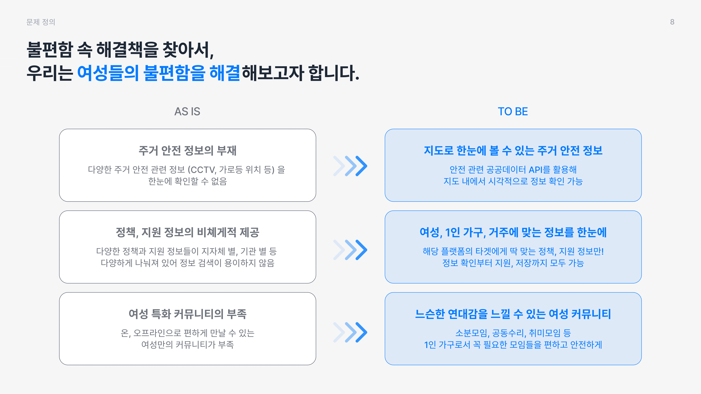
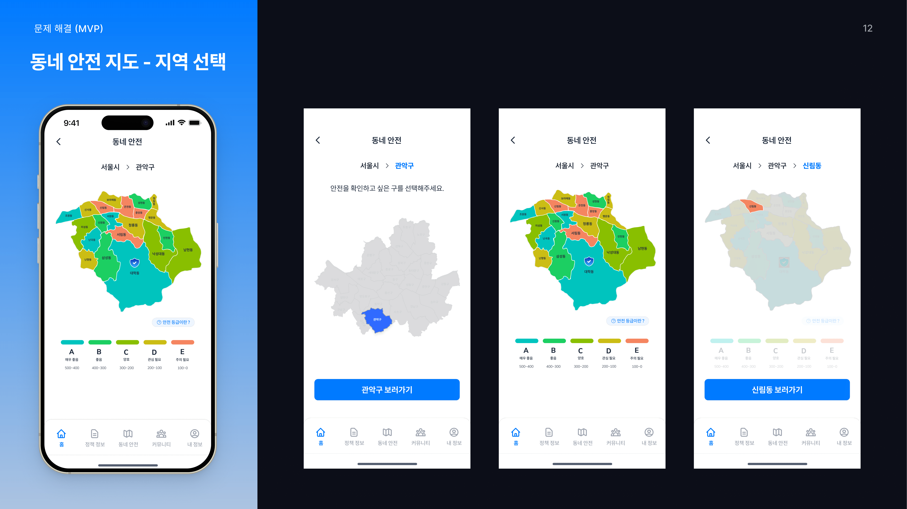
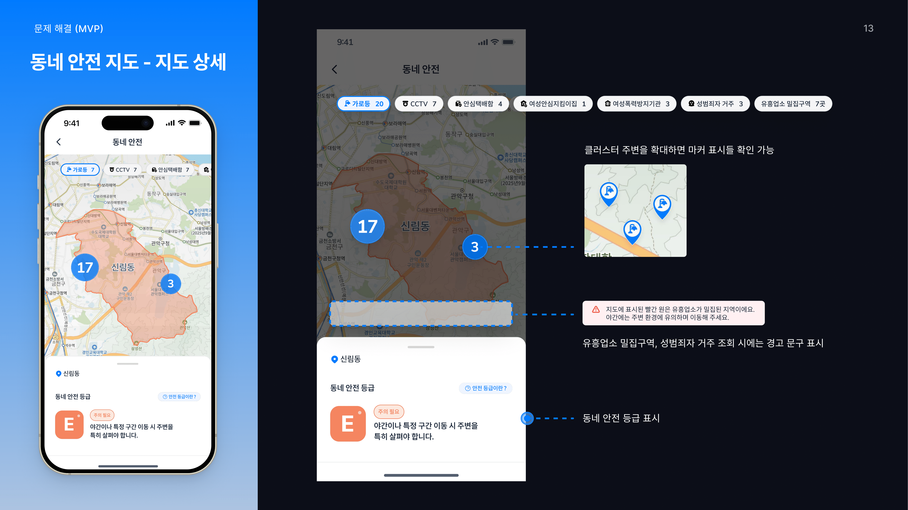

# 시소 프로젝트 소개

여성의 경험이 모여 만든, 믿을 수 있는 주거 안전 앱

**시소**는 여성 1인 가구가 혼자여도 안전하고, 함께여서 더 든든한 주거 생활을 영위하는 것이 목표입니다.

조금이라도 더 안전할 수 있도록, 안전에 기반되는 **안전지도맵, 정책알림, 소분모임 커뮤니티**를 제공합니다.









<video width="100%" controls>
  <source src="public/assets/preview.mp4" type="video/mp4">
  Your browser does not support the video tag.
</video>

## Getting Started

This project uses **pnpm** as the package manager. Please use pnpm for all package management operations.

First, install dependencies:

```bash
pnpm install
```

Then, run the development server:

```bash
pnpm run dev
```

Open [http://localhost:3001](http://localhost:3001) with your browser to see the result.

## Tech Stack

### Core Framework

- **Next.js 13** - React framework with App Router
- **TypeScript** - Type safety
- **React 18** - UI library

### State Management

- **React Query (@tanstack/react-query)** - Server state management
- **React Hook Form** - Form state management

### Styling & UI

- **Tailwind CSS** - Utility-first CSS framework
- **shadcn/ui** - Modern component library
- **PostCSS** - CSS post-processing
- **SCSS** - Sass preprocessing (legacy styles)

### Utility Libraries

- **clsx** - Conditional class name utility
- **tailwind-merge** - Tailwind class merging utility
- **class-variance-authority** - Component variant management

### Development Tools

- **ESLint 9** - Linting with flat config
- **Prettier** - Code formatting
- **Husky** - Git hooks
- **lint-staged** - Pre-commit linting

## Project Structure

```
├── app/           # Next.js App Router pages
├── components/    # Reusable components
│   └── ui/        # shadcn/ui components
├── hooks/         # Custom hooks
├── lib/           # Utility libraries
├── styles/        # Global styles and SCSS utilities (legacy)
├── types/         # TypeScript type definitions
└── utils/         # Utility functions
    └── cn.ts      # Class name utility (shadcn/ui)
```

## Commands

```bash
# Development
pnpm run dev          # Start development server
pnpm run build        # Build for production
pnpm run start        # Start production server

# Code Quality
pnpm run lint         # Run ESLint
pnpm run lint:fix     # Fix ESLint issues
pnpm run format       # Format code with Prettier

# shadcn/ui
pnpm dlx shadcn@latest add [component]  # Add shadcn/ui components
```
